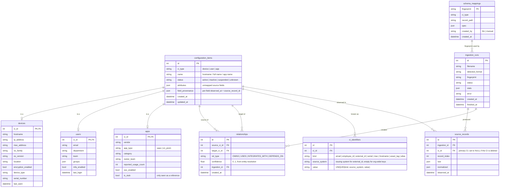

# stlabs-assessment-backend-cmbd
STLabs Take Home (Backend CMDB)

## Data Model

Every configuration item (CI) has one row in `configuration_items` holding the shared fields, plus one row in its type table (`devices`, `users` or `apps`) with the same id (joined-table inheritance). `relationships` links any two CIs, so one table covers device ownership, app usage and app integrations.

Notes:
- **Names are not unique.** Two users can both be called "John Doe". Identity comes only from strong keys in `ci_identifiers` (emails, employee IDs, serials, source-system IDs), each of which can belong to only one CI (`UNIQUE(kind, source_system, value)`).
- **System-issued IDs are scoped to their system.** Okta's user `u_110` and another tool's `u_110` are unrelated, so `external_id` identifiers carry a `source_system`. Org-wide keys (email, serial, MAC, ...) leave it empty so they match across sources.
- **Source records are permanent history.** Deleting a CI detaches its raw records (`ci_id` becomes NULL) instead of deleting them, so they stay available for audit and for rebuilding CIs.
- **A device has at most one owner.** A partial unique index on `relationships(target_ci_id) WHERE rel_type = 'OWNS'` enforces this.
- The link from `schema_mappings` to `ingestion_runs` is logical rather than a foreign key: a run records the fingerprint it matched, and that fingerprint's mapping may only be created partway through the run.
